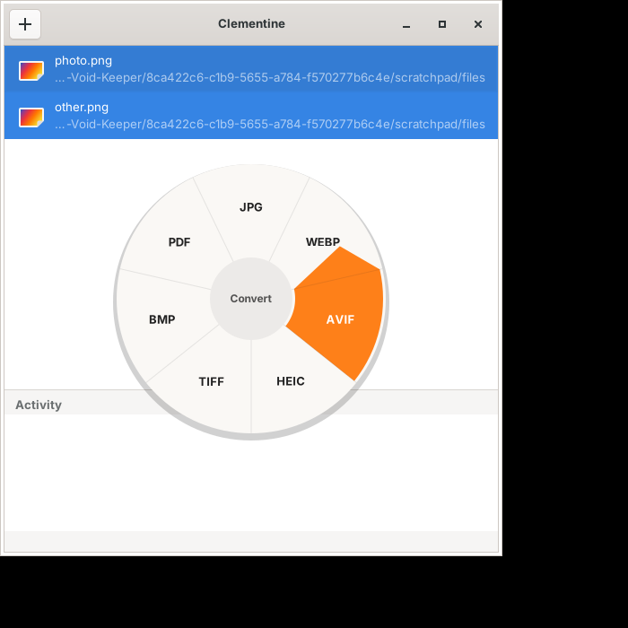

# Clementine

A zero-click, offline file converter for Linux. Drag a file onto the window, tap a modifier,
and drop it on a format. Inspired by [Tangerine](https://tangerineformac.com/) for Mac.



Everything runs on your computer: nothing is uploaded, and an input file is never overwritten —
results land next to it (or in a folder you choose) as `name.ext`, or `name (2).ext` when that is taken.

## Using it

| While dragging over the window | Opens |
|---|---|
| **Shift** (default) | the conversion wheel |
| **Ctrl** (default) | the tools wheel (compress, resize, rotate, split, merge, extract, zip…) |
| **Alt** (default) | the actions wheel (copy, copy path, copy to…, move to…, show in Files, terminal) |

The wheel stays open until you drop. Drop on a slice to run it, or on the hub to cancel.
A drop without a wheel puts the files on the **shelf**.

**Wayland:** a window is not told about keys pressed while a drag from *another* app hovers it.
So while dragging, three chips appear at the bottom of the window; drag over one to open its wheel.
Modifier keys work when dragging from the shelf, and on X11.

**Keyboard:** select files on the shelf and press **Enter**. Arrows choose a slice, **Tab** switches
wheels, **Enter** runs, **Esc** cancels. **Delete** removes files from the shelf. Shelf rows can be
dragged out to a file manager or back onto the window.

**Settings** (the gear in the header bar) change which modifier opens which wheel (Shift, Ctrl, Alt or
Super, each on one wheel only), whether results go next to the original or into one folder, and whether
results are added to the shelf. Changes apply at once and are saved to
`~/.config/clementine/config.json` (`$XDG_CONFIG_HOME` is honoured); a missing or broken file means defaults.

A slice is grey when a program it needs is missing; hover it to see which.

## What it converts

| From | To | Through |
|---|---|---|
| Images: JPG PNG WebP HEIC AVIF TIFF BMP GIF SVG | JPG PNG WebP AVIF HEIC TIFF BMP PDF | ImageMagick |
| Audio: MP3 M4A WAV FLAC OGG Opus AIFF WMA AAC | MP3 M4A WAV FLAC OGG Opus AIFF | ffmpeg |
| Video: MP4 MOV MKV WebM AVI WMV MPG FLV | MP4 MOV MKV WebM AVI GIF MP3 | ffmpeg |
| PDF | PNG / JPG (every page, 300 DPI), TXT, DOCX | poppler, LibreOffice |
| Documents: DOCX ODT RTF MD TXT HTML EPUB | DOCX ODT PDF MD TXT HTML EPUB | pandoc, LibreOffice |
| Spreadsheets: XLSX XLS ODS CSV TSV | XLSX ODS CSV TSV PDF | LibreOffice |
| Slides: PPTX PPT ODP | PDF PPTX ODP PNG JPG | LibreOffice, poppler |
| Subtitles: SRT VTT | SRT VTT TXT | ffmpeg, built-in |
| Archives: ZIP TAR TAR.GZ RAR 7Z | ZIP TAR TAR.GZ | unzip, tar, unrar, 7z |

## Install

**Debian / Ubuntu (.deb).** Download `clementine_*.deb` from the GitHub releases page, or build it
(see below), then:

```sh
sudo apt install ./clementine_0.1.0-1_amd64.deb
```

apt pulls in GTK 4 and recommends the converters (ffmpeg, ImageMagick, pandoc, poppler-utils, zip,
unzip). LibreOffice, unrar, p7zip and ghostscript are suggested, not installed.

**Flatpak.** The manifest is `flatpak/io.github.sphanx.Clementine.yml`; it is not on Flathub yet.

```sh
flatpak install --user flathub org.gnome.Platform//51 org.gnome.Sdk//51 \
    org.freedesktop.Sdk.Extension.rust-stable//26.08
flatpak-builder --user --install --force-clean build-dir flatpak/io.github.sphanx.Clementine.yml
```

The Flatpak bundles ffmpeg (with MP3 via lame), pandoc, zip, unzip and poppler-utils. It does **not**
bundle ImageMagick, LibreOffice, unrar, p7zip or ghostscript, so those conversions stay greyed out
inside the sandbox. Clementine does not call host programs through `flatpak-spawn`.

**From source.** See *Building*.

## Building

```sh
# Debian / Ubuntu
sudo apt install libgtk-4-dev ffmpeg imagemagick pandoc poppler-utils libreoffice zip unzip ghostscript
cargo build --release
./target/release/clementine [files…]
```

GTK 4.14 or newer. The converters are optional; install the ones you need.

```sh
cargo test                               # fast unit tests
cargo test -- --ignored --nocapture      # every conversion on real sample files
```

## Layout

| File | What it holds |
|---|---|
| `src/catalog.rs` | File kinds, and which conversions / tools / actions each selection gets |
| `src/backend.rs` | Turns an op into commands, names outputs, runs them off the UI thread |
| `src/wheel.rs` | The radial menu: state, hit testing, drawing |
| `src/actions.rs` | The actions wheel: clipboard, copy/move, file manager, terminal |
| `src/config.rs` | Settings: the JSON file, defaults, modifier assignment |
| `src/settings_ui.rs` | The Settings window |
| `src/main.rs` | The window, drag and drop, keyboard |

## Not yet

- Trim / crop / split for audio and video (they need a range picker)
- A global drop target outside the window (possible on X11 only)
